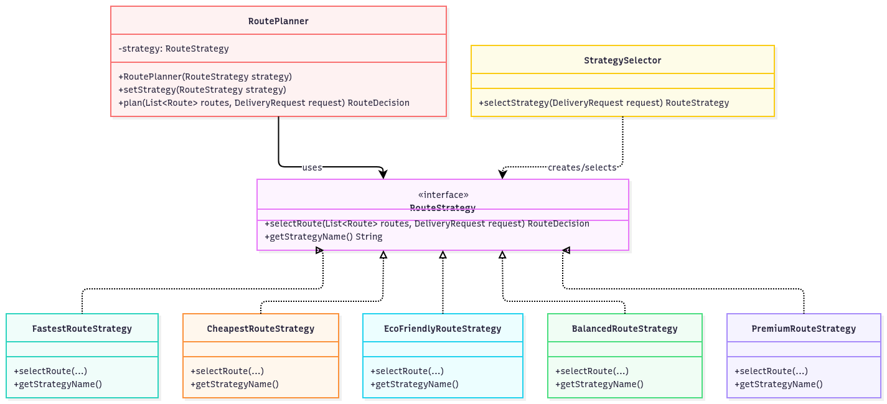
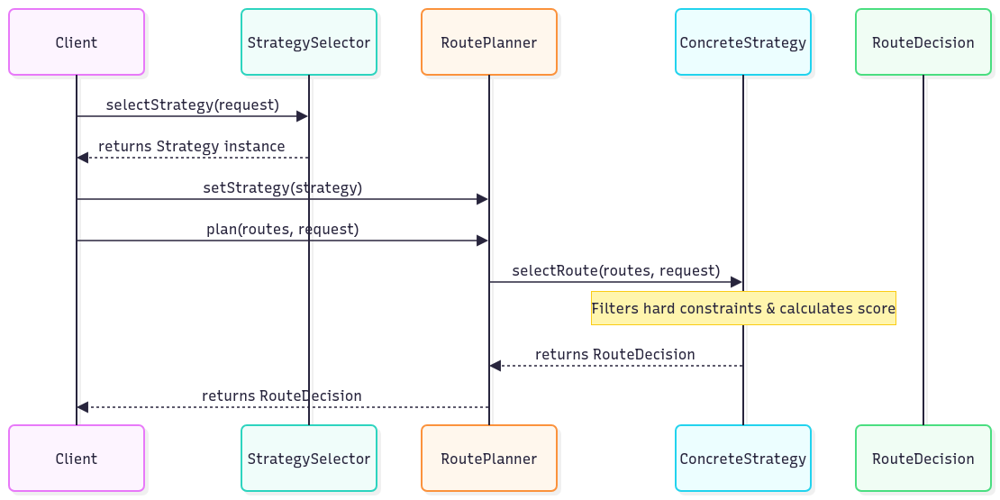

# Smart Delivery & Route Optimization Engine (Strategy Pattern)

## 1. Project Overview
A Java 17+ application developed for a logistics company to optimize delivery routes dynamically based on multiple criteria (time, cost, eco-impact, balanced weights, and premium conditions) using the **Strategy Design Pattern**.

---

## 2. Architecture & Design Patterns

### Answers to Assignment Questions:
* **What problem does Strategy solve?** It eliminates complex, hard-to-maintain `if-else` or `switch` statements when selecting algorithms, encapsulating each route-selection algorithm into its own interchangeable class.
* **Where is the Context?** `planner.RoutePlanner`.
* **Where is the Strategy interface?** `strategy.RouteStrategy`.
* **What are the Concrete Strategies?** `FastestRouteStrategy`, `CheapestRouteStrategy`, `EcoFriendlyRouteStrategy`, `BalancedRouteStrategy`, and `PremiumRouteStrategy`.
* **Where is runtime strategy switching demonstrated?** In `Main.java` and unit tests using `planner.setStrategy(...)` while keeping the same Context object.
* **Difference between Strategy and Bridge:** Strategy focuses on interchangeable behavior (how a task is done), whereas Bridge decouples an abstraction from its implementation so the two can vary independently.
* **SOLID Principles:**
  * **SRP:** Separation of concerns between Context, StrategySelector, and individual algorithms.
  * **OCP:** New strategies can be added with minimal or zero changes to existing code.
  * **DIP:** `RoutePlanner` depends on the `RouteStrategy` abstraction, not concrete implementations.

---

## 3. UML Diagrams

### Class Diagram


### Sequence Diagram




---

## 4. Example Console Output

```text
=== SMART DELIVERY & ROUTE OPTIMIZATION ENGINE ===

[1] Fastest Strategy: Selected Route F (VIP) with minimum delivery time of 18 mins.
[2] Cheapest Strategy: Selected Route A (Express) with lowest cost of 5000.00.
[3] Auto-selected (Fastest Route Strategy): Selected Route F (VIP) with minimum delivery time of 18 mins.
```

---

## 5. JUnit 5 Test Results

* **Total Tests:** 15 meaningful automated tests.
* **Status:** All 15 tests passed successfully, covering strategies, constraints, exceptions, and runtime switches.


* **Why Strategy over if/else?** It isolates changing algorithms from the business logic, avoids huge unmaintainable switch/if-else blocks, and allows adding new algorithms without modifying existing client code.
* **How to add a new Strategy:** Implement the `RouteStrategy` interface, code the `selectRoute(...)` algorithm, and optionally register it in `StrategySelector`. Zero changes to `RoutePlanner`.
* **Current Architecture Limitations:** Strategies evaluate candidate routes independently in memory and do not dynamically recalculate live graph nodes/routing hops on the fly.